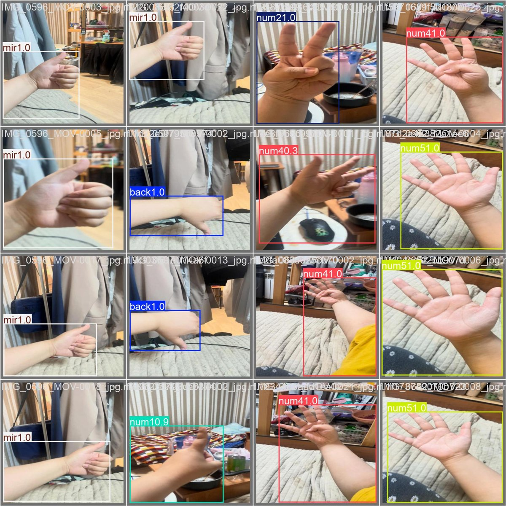
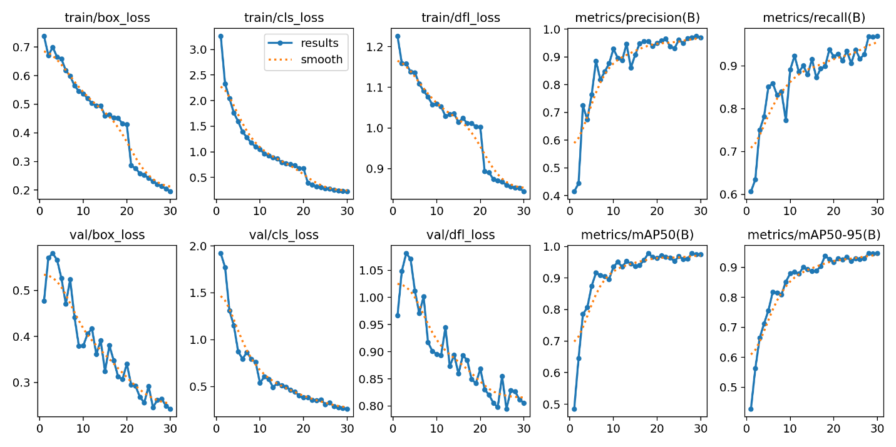
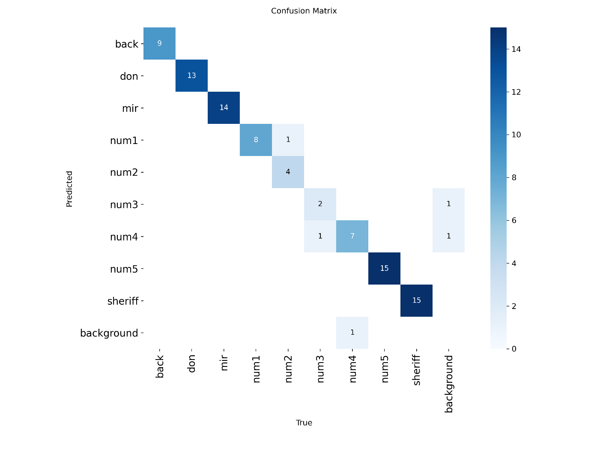

# Детектор жестов «Спортивной мафии»

Модель находит на кадре руку игрока и распознаёт жест: **чёрный (мафия), дон, мирный,
шериф** и **номера 1–5**. Её можно использовать для автоматической разметки
видеотрансляций турниров по спортивной мафии.



## Результаты

| Выборка | mAP@50 | mAP@50-95 | Precision | Recall |
|---|---|---|---|---|
| valid | 0.975 | 0.947 | 0.969 | 0.970 |
| test (90 изобр.) | **0.968** | **0.959** | - | - |

| Кривые обучения | Матрица ошибок (test) |
|---|---|
|  |  |

Ошибки встречаются только между похожими цифрами (`num2→num1`, `num3→num4`).
Ограничения и возможная утечка между кадрами одного видео описаны в
[model card](reports/model_card.md).

## Данные
* **~900 кадров** из собственных видео, разные ракурсы и освещение. Открытого датасета по теме не было.
* Разметка вручную в Roboflow (bbox, формат YOLO), **9 классов**.
* Разбиение 80/10/10. Аугментации train (шум, яркость, поворот ±15°) расширили его примерно до 2500 изображений.

## Модель
YOLOv8n (~3 млн параметров), дообученная с COCO. Выбрана Nano, потому что
жесты нужно распознавать на трансляции в реальном времени, а объекты
(кисти рук) крупные и средние. Лосс: BCE для классов, CIoU + DFL для рамок.
Гиперпараметры `lr0` и `momentum` подбираются эволюционным тюнером Ultralytics.

## Быстрый старт

```bash
git clone https://github.com/tanyalebedeva/mafia-gesture-detector.git
cd mafia-gesture-detector
python -m venv .venv && source .venv/bin/activate      # Windows: .venv\Scripts\activate
pip install -r requirements.txt
python -m mafia_cv.predict path/to/photo.jpg --save
python -m mafia_cv.predict 0 --show                     # веб-камера

pip install -r requirements-app.txt && python app.py    # http://127.0.0.1:7860
```

### Проверка утечки train/test

```bash
python -m mafia_cv.leakage datasets/mafia-cv-1
python -m mafia_cv.leakage datasets/mafia-cv-1 --resplit datasets/mafia-cv-grouped
```

## Структура

```
mafia_cv/
  classes.py    имена классов и исправление опечатки разметки (back -> black)
  data.py       загрузка датасета из Roboflow (ключ только из окружения)
  train.py      подбор гиперпараметров -> обучение -> оценка на test
  evaluate.py   метрики общие и по классам -> reports/metrics_*.{json,md}
  predict.py    инференс: фото, папка, видео, веб-камера
  leakage.py    проверка пересечения выборок и разбиение по видео
app.py          Gradio-демо
configs/        гиперпараметры
models/best.pt  обученные веса (6 МБ)
reports/        model card и метрики
tests/          pytest (включая смоук-тест модели), запускаются в GitHub Actions
```
